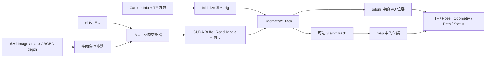

# Isaac ROS Visual SLAM：初步源码分析

分析日期：2026-10-06。基线：`release-5.0` / `e4dc8f59816dfca387bcb92364ecaf9207216475`。本轮只做静态阅读与插入中文注释，没有构建、运行 ROS、连接相机或验证定位精度。

## 先抓住项目边界

该仓库把相机图像、标定和可选 IMU 接入 cuVSLAM，并把估计结果发布为 ROS 位姿、里程计、轨迹与 TF。它负责当前状态估计；学习式世界模型的未来预测不在这里实现。

Isaac ROS 5.0.0 将 ROS 算法包从 `isaac_ros_visual_slam` 改为 `isaac_ros_cuvslam`；GitHub 仓库名、接口包 `isaac_ros_visual_slam_interfaces`、C++ 插件 `nvidia::isaac_ros::visual_slam::VisualSlamNode` 和 `visual_slam/*` topic 保留现有命名。该版本使用 ROS 2 Lyrical，并以 `rosidl::Buffer` / CUDA Buffer 后端替代旧版 NITROS 图像传输。版本背景见[官方发布说明](https://nvidia-isaac-ros.github.io/releases/index.html)，当前入口见[cuVSLAM 包文档](https://nvidia-isaac-ros.github.io/repositories_and_packages/isaac_ros_visual_slam/isaac_ros_cuvslam/index.html)。

## 实际阅读和注释范围

这是初步分析，选取以下 8 个文件串起数据流；其它源码、测试、可视化实现和子模块算法还未逐个注释。完整选择记录在 [annotation_scope.json](annotation_scope.json)。

| 文件 | 本轮重点 |
|---|---|
| [core launch](../isaac_ros_cuvslam/launch/isaac_ros_visual_slam_core.launch.py) | 格式转换器、组件片段、launch 默认值与重映射 |
| [RealSense launch](../isaac_ros_cuvslam/launch/isaac_ros_visual_slam_realsense.launch.py) | 双目红外 + IMU 的 VIO 示例 |
| [visual_slam_node.hpp](../isaac_ros_cuvslam/include/isaac_ros_cuvslam/visual_slam_node.hpp) | 参数、模式、topic、服务与实现对象声明 |
| [visual_slam_node.cpp](../isaac_ros_cuvslam/src/visual_slam_node.cpp) | ROS 接口注册、GPU 预热、服务响应语义 |
| [visual_slam_impl.hpp](../isaac_ros_cuvslam/include/isaac_ros_cuvslam/impl/visual_slam_impl.hpp) | 同步器、交织器、SDK 对象、CUDA 流与定位 future |
| [visual_slam_impl.cpp](../isaac_ros_cuvslam/src/impl/visual_slam_impl.cpp) | 初始化、Track、TF 与输出、异步定位 |
| [message_stream_sequencer.hpp](../isaac_ros_cuvslam/include/isaac_ros_cuvslam/impl/message_stream_sequencer.hpp) | IMU 快流与图像慢流的缓存交织 |
| [cuvslam_ros_conversion.cpp](../isaac_ros_cuvslam/src/impl/cuvslam_ros_conversion.cpp) | 内外参、换基、图像视图与协方差转换 |

还阅读了 [.gitmodules](../.gitmodules)、[package.xml](../isaac_ros_cuvslam/package.xml)、[CMakeLists.txt](../isaac_ros_cuvslam/CMakeLists.txt)、[types.hpp](../isaac_ros_cuvslam/include/isaac_ros_cuvslam/impl/types.hpp) 与原 README，用于核对依赖、版本和消息类型。

## 以一组双目数据追踪执行路径

1. `VisualSlamNode` 按 `num_cameras` 订阅 `visual_slam/image_i` 与 `visual_slam/camera_info_i`。图像订阅接受任意 Buffer 后端；GPU 指针由实现层取得，不能仅凭标准消息类型判断像素在 CPU 还是 GPU。
2. `CallbackCameraInfo` 在未初始化时缓存各路标定；VIO 还要求首个 IMU 已到达。内参取 `K` 中 `fx/fy/cx/cy` 和畸变参数，外参从 TF 的 `base→camera optical` 查询；整流图像配置还使用 `R` 的逆修正相机外参。CameraInfo 是初始化输入，没有与每帧 Image 做逐帧同步。
3. 图像采集时间以纳秒进入 `MessageStreamSynchronizer`。启用的 mask 和 RGBD 深度占用额外索引。同步组再作为慢流进入 `MessageStreamSequencer`，与一批 IMU 组合交给 `UpdatePose`。
4. `UpdatePose` 先登记该批 IMU，再为图像/mask/depth 创建 `cuda_buffer_backend::ReadHandle`。句柄容器存活到 `Track` 返回；调用前还显式同步包装层 CUDA 流，避免 SDK 内部流读取尚未完成的生产者数据。
5. `Odometry::Track` 的 `world_from_rig` 有值才算跟踪成功。若开启 `enable_localization_n_mapping`，再把 odometry state 交给 `Slam::Track` 获取含地图修正的位姿。

## 接口、时间与坐标约定

| 接口/参数 | 源码中的实际语义 |
|---|---|
| `tracking_mode` | `0` 多相机、`1` VIO、`2` RGBD；只有 VIO 建立 IMU 订阅，只有 RGBD 建立 `depth_0` 订阅 |
| 跟踪图像 | 转换层接受 `mono8` / `rgb8`，消息宽高与 `step` 传给 SDK 图像视图 |
| RGBD 深度 | 接受 `16UC1` / `mono16` / `32FC1`；缩放与对齐相机由 `depth_scale_factor`、`depth_camera_id` 配置 |
| `camera_optical_frames` | 可覆盖 CameraInfo 的 `frame_id`；初始化需要与基座连通的 TF |
| `visual_slam/tracking/vo_pose`、`tracking/odometry` | 位姿在 `odom_frame`，里程计子系是 `base_frame` |
| `tracking/slam_path`、`vis/slam_odometry` | 位姿在 `map_frame`；回环可导致地图位姿跳变 |
| TF | 默认发布 `map→odom→base`，可分别禁用或反转；相机/IMU 外参由其它节点提供 |
| 协方差 | SDK 的旋转在前、平移在后转换为 ROS 平移在前、旋转在后，并换坐标基 |
| 四元数 | SDK 与 tf2 转换按 `x,y,z,w` 填写；不能直接套用采用 `w,x,y,z` 的其它库接口 |

代码中的 `T_map_odom = T_map_base * inverse(T_odom_base)` 是理解两种参考系的关键。`ChangeBasis(R,T)` 计算 `R*T*R^-1`，它与把相机外参乘到位姿上的单边组合不是同一操作。图像同步匹配阈值在构造处由毫秒乘 `1e6` 转为纳秒；`override_publishing_stamp` 可以将输出时间替换为当前时间，研究数据对齐时需记录是否开启。

`core.launch.py` 的片段方法返回参数声明，但其独立 `generate_launch_description()` 只加入组件容器，没有加入 `get_launch_actions()` 的结果。RealSense 专用 launch 直接给出具体参数，选择 `tracking_mode=1`。这些是源码连接关系，尚未进行 launch 运行验证。

## 外部依赖和本轮未覆盖的算法

`.gitmodules` 记录 `cuvslam` 来自 `nvidia-isaac/cuVSLAM`，跟踪分支为 `main`；基线 gitlink 固定为 **`33da60662b27c0c5b63e0597bd778066af2731ed`**。复现时应按 gitlink 获取，不把“分支最新”当成这个版本。核心源码已公开，使用其独立 NVIDIA Community License；ROS 包的 Apache-2.0 许可证不能代替子模块许可证。见[固定核心源码](https://github.com/nvidia-isaac/cuVSLAM/tree/33da60662b27c0c5b63e0597bd778066af2731ed)。本轮没有初始化或递归下载子模块。

ROS 包 CMake 用 `ExternalProject` 从该目录构建 `libcuvslam.so` / API launcher；节点启动检查 SDK 主/次版本 `15.0`。还依赖 CUDA Toolkit、`cuda_buffer`、`isaac_common` / `isaac_ros_common`、Boost、Eigen、tf2 与 ROS 消息。示例的相机驱动、图像转换包及模型工作流并不都在此仓库内。

## 已发现、保持原样的待核对点

- `VisualSlamImpl` 为 sequencer 直接传入 `imu_jitter_threshold_ms` / `image_jitter_threshold_ms` 数值，而 sequencer 用纳秒时间戳做整数差比较。图像 synchronizer 有乘 `1e6`，这条路径没有；这是明确的单位接口疑点，运行影响尚未验证。
- 保存地图实现返回 `bool`，但 ROS `CallbackSaveMap` 未使用返回值，未抛异常就设响应成功；服务成功不能直接证明文件保存成功。
- `CallbackLocalizeInMap` 的响应成功表示异步请求已发起；最终结果由 `CheckLocalizationStatus` 检查。初始化里的自动定位另外使用 detached thread，应单独核对关闭时的资源生命周期。
- 内参/外参在初始化阶段读取；当前已读路径没有自动跟随后续 CameraInfo 重新标定。需要改变标定时先研究 reset/reinitialize 行为。

这些观察只描述当前基线，未做行为修复，也不表示已完成运行时错误复现。

## 与 PyRoki、nvblox 和 WLA 的学习连接

PyRoki 提供基座/末端位姿和 `SE(3)` 优化的基础；这里把真实传感器观测放到一致的机器人参考系。nvblox 可用此 TF 链把深度融合到几何地图。WLA 的机器人状态、图像时间、动作参考系和动作 chunk 执行周期仍需单独适配，当前仓库没有 WLA 策略接口。不要把 VO 相机基座状态直接等同于机械臂关节状态或 WLA 完整 state 向量。

第一项静态练习：从 RealSense launch 任选 `infra1`，按 remapping 追到 `CallbackImage(0)` → `sync` → `sequencer` → `UpdatePose`，在学习日志填写采集时间、Buffer 所有者、CameraInfo 来源、`T_base_camera` 与最终 `T_odom_base`；再解释为什么 map 回环修正不能直接当作连续控制增量。做完这张数据契约表后再准备 GPU/ROS 环境与录包验证。

## 2026-10-06 本地提交授权

用户已明确授权将 PyRoki、WLA 和 5 个 Isaac ROS 仓库的本轮注释、代码树及分析材料提交到各自学习分支。本文中“未提交／等待审查”描述的是准备阶段；本轮将创建本地 commit，验证仍使用固定上游基线。提交版本统一登记在学习流水线的提交记录中。运行实验尚未执行。
